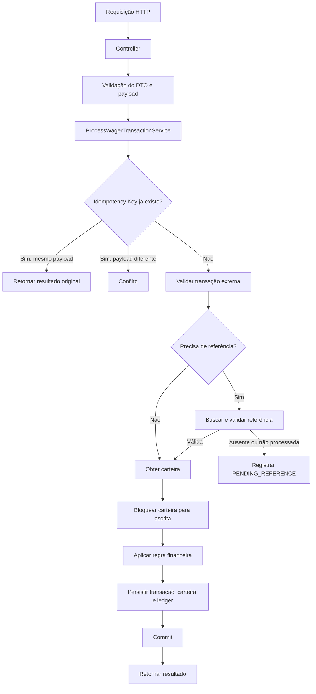

# Arquitetura — Distributed Wagering Processor

## 1. Objetivo

Este documento descreve a organização interna da aplicação, as responsabilidades de cada camada, o fluxo de processamento de uma transação e as principais decisões técnicas adotadas.

A implementação atual utiliza uma arquitetura em camadas. A proposta foi manter uma separação clara entre entrada HTTP, coordenação dos casos de uso, regras de negócio e persistência, sem introduzir abstrações desnecessárias para o escopo e o tempo disponíveis.

A arquitetura distribuída completa descrita no desafio não foi finalizada. As partes implementadas e as evoluções planejadas são diferenciadas ao longo deste documento.

## 2. Visão geral das camadas

A aplicação está organizada da seguinte maneira:

```text
src/
├── application/
│   └── services/
├── business-logic/
│   ├── entities/
│   └── value-objects/
├── config/
├── data-access/
│   ├── entities/
│   └── repositories/
└── presentation/
    ├── controllers/
    └── dtos/
```

### Presentation

Responsável pela comunicação com o exterior da aplicação.

Contém controllers e DTOs, recebendo requisições HTTP, validando os dados de entrada e convertendo os resultados dos casos de uso em respostas HTTP.

Essa camada não concentra as regras financeiras do domínio.

### Application

Responsável por coordenar os casos de uso.

Os serviços dessa camada organizam as etapas necessárias para executar uma operação, utilizando as regras do domínio e os componentes de persistência.

Exemplo: `ProcessWagerTransactionService` coordena a validação e o processamento de uma transação de aposta.

### Business Logic

Contém as regras de negócio e os conceitos centrais da aplicação.

Entre os elementos implementados estão:

- `Wallet`: representa a carteira e controla operações de crédito e débito.
- `WagerTransaction`: representa uma transação de aposta e suas transições de estado.
- `Money`: Value Object que representa valores monetários com precisão decimal.
- `WalletLedgerEntry`: representa uma movimentação financeira associada à carteira.

A intenção é manter as regras do domínio independentes de detalhes do NestJS, HTTP e MikroORM.

### Data Access

Responsável pela persistência.

Contém as entidades utilizadas pelo MikroORM e os repositórios que encapsulam as consultas e operações no PostgreSQL.

Os repositórios fazem a comunicação entre os serviços da aplicação e os dados persistidos.

### Config

Centraliza configurações necessárias para inicialização da aplicação e conexão com o banco de dados.

## 3. Modelo de domínio

### Money

O `Money` é um Value Object imutável que representa um valor e sua moeda.

Foi utilizado `Decimal.js` para realizar operações decimais sem depender da precisão binária de valores `number` do JavaScript, como requisitado no desafio.

As principais validações incluem:

- Valor não negativo.
- Até duas casas decimais.
- Rejeição de notação científica.
- Validação das moedas suportadas.

A representação textual do valor é preservada para evitar conversões desnecessárias para ponto flutuante.

### Wallet

A `Wallet` representa a carteira de um jogador em uma moeda específica.

Suas responsabilidades incluem:

- Manter o saldo.
- Realizar débitos e créditos.
- Impedir saldo negativo.
- Controlar a versão da carteira.

A identificação da carteira considera jogador e moeda, permitindo representar carteiras distintas para moedas diferentes.

### WagerTransaction

A `WagerTransaction` representa uma operação recebida do provedor.

Os tipos tratados pelo domínio são:

- `OPENING`
- `BET`
- `WIN`
- `LOSS`
- `REFUND`
- `ROLLBACK`

Os estados definidos incluem:

- `PENDING`
- `PENDING_REFERENCE`
- `PROCESSED`
- `REJECTED`
- `FAILED`

A entidade também concentra comportamentos relacionados às transições de estado, necessidade de referência e direção da movimentação financeira.

### WalletLedgerEntry

Representa uma entrada do histórico financeiro da carteira.

As movimentações de crédito e débito são registradas para permitir rastrear como o saldo foi alterado.

Uma operação `LOSS` não gera movimentação no ledger, pois não altera o saldo.

## 4. Fluxo de processamento de uma transação

O fluxo HTTP implementado pode ser resumido assim:



Em suma:

1. O controller recebe a requisição e encaminha os dados para o serviço de aplicação.
2. O serviço verifica a chave de idempotência e o hash do payload.
3. É verificada a existência de uma transação externa duplicada.
4. Quando necessário, a transação de referência é consultada e validada.
5. A carteira é obtida com bloqueio pessimista de escrita.
6. As regras financeiras são aplicadas.
7. A transação, a atualização da carteira e a entrada do ledger são persistidas na mesma transação do banco de dados.
8. Após a conclusão da operação, o resultado é retornado ao controller.

O diagrama representa o fluxo síncrono implementado. O reprocessamento automático de `PENDING_REFERENCE` ainda não faz parte da aplicação.

## 5. Consistência financeira e transações SQL

As operações que alteram o saldo precisam manter consistência entre:

- Saldo atual da carteira.
- Transação de aposta.
- Entrada correspondente no ledger.

Por isso essas alterações são realizadas dentro de uma transação do PostgreSQL.

A intenção é garantir que as alterações relacionadas sejam confirmadas juntas. Caso ocorra uma falha antes do commit, as alterações daquela transação SQL devem ser revertidas.

### Concorrência sobre a carteira

O repositório utiliza `PESSIMISTIC_WRITE` na consulta da carteira durante o processamento.

A solução foi implementada no acesso ao banco, e não apenas com verificações em memória.

**Limitação:** ainda faltam os testes de integração de concorrência e de múltiplas instâncias exigidos pelo desafio. Portanto, essa estratégia foi implementada, mas não foi validada em todos os cenários de carga e distribuição propostos.

## 6. Idempotência

A API recebe a chave de idempotência pelo header `Idempotency-Key`.

A chave e o hash do payload são persistidos no banco de dados. O hash permite identificar se uma requisição posterior representa o mesmo conteúdo da operação original.

Comportamento esperado na implementação atual:

| Situação | Comportamento |
|---|---|
| Chave existente e payload igual | Retorna o resultado já persistido |
| Chave existente e payload diferente | Retorna conflito |
| Chave ainda não utilizada | Prossegue com o processamento |

A persistência da chave evita depender exclusivamente de cache em memória, que não seria suficiente para garantir idempotência após reinicializações ou entre instâncias.

Ainda é necessário validar e fortalecer os cenários de requisições simultâneas utilizando a mesma chave, incluindo o comportamento em caso de disputa pela restrição de unicidade no banco.

## 7. Referências e reversões

As operações `REFUND` e `ROLLBACK` dependem de uma transação de referência.

A validação considera dados como:

- Tipo da transação original.
- Provedor.
- Jogador.
- Carteira.
- Moeda.
- Rodada.
- Valor.

O `REFUND` é utilizado para reverter uma aposta processada. O `ROLLBACK` representa a operação inversa de uma transação elegível.

Quando a referência não está disponível ou ainda não foi processada, a transação pode ser persistida como `PENDING_REFERENCE`.

**Ponto pendente:** o worker responsável por consultar novamente essas referências, aplicar backoff e encerrar tentativas após o TTL não foi implementado.

## 8. Ledger

O ledger mantém o histórico das movimentações financeiras.

A direção da movimentação depende do tipo de transação e, no caso das reversões, da operação original.

A atualização do saldo e a inserção da entrada do ledger são realizadas no mesmo contexto transacional do banco de dados.

Isso permite manter uma trilha persistente das movimentações e fornece a base para uma futura implementação de reconciliação entre o saldo da carteira e o histórico financeiro.

O endpoint e o processo automatizado de reconciliação ainda não foram concluídos.

## 9. Arquitetura distribuída proposta e itens pendentes

O desafio também propõe o processamento orientado a eventos utilizando SQS. Essa parte não foi implementada na versão entregue.

A evolução planejada seria:

### Transactional Outbox (não implementado)

O padrão Outbox permitiria persistir o evento a ser publicado na mesma transação SQL que altera a carteira, a transação e o ledger.

Um processo consultaria os eventos pendentes e os publicaria na fila.

Dessa forma, a aplicação não dependeria de publicar uma mensagem antes de confirmar os dados no banco, evitando eventos referentes a operações que sofreram rollback.

### Inbox (não implementado)

O padrão Inbox permitiria registrar as mensagens já processadas, utilizando uma identificação como `(consumerName, messageId)`.

O consumidor verificaria a existência desse registro para evitar processar novamente a mesma mensagem.

O registro da Inbox e as alterações de negócio deveriam ocorrer na mesma transação SQL. O ACK da mensagem seria enviado somente após o commit.

### SQS FIFO, retries e DLQ (não implementado)

A fila FIFO poderia ajudar a preservar a ordem dentro de um grupo de mensagens, mas não substituiria as garantias de consistência do banco de dados.

Também seria necessário implementar:

- Política de retry e backoff.
- Dead Letter Queue (DLQ).
- Tratamento de falhas temporárias e permanentes.
- Encerramento controlado dos workers.
- Recuperação de mensagens após falhas.

Esses componentes permanecem como trabalho futuro; não fazem parte do fluxo executável atual.

## 10. Segurança e observabilidade

A autenticação não foi implementada. O desafio permite omiti-la, desde que a decisão seja documentada.

Também não foram concluídos os endpoints de health check, métricas e a camada de observabilidade estruturada prevista no escopo original.

Esses itens devem ser considerados pendências, e não funcionalidades disponíveis na versão atual.

## 11. Próximos passos, que faltaram para a conclusão

Para aproximar a implementação dos requisitos do desafio, os próximos passos seriam:

1. Completar os endpoints de consulta de carteira, ledger e transações.
2. Implementar reconciliação e health checks.
3. Implementar o reprocessamento de referências pendentes.
4. Adicionar Outbox e Inbox com persistência transacional.
5. Integrar SQS e implementar workers, retries e DLQ.
6. Adicionar testes de concorrência, múltiplas instâncias e recuperação após falhas.
7. Fortalecer os cenários de idempotência concorrente.
8. Implementar observabilidade e, se necessário, autenticação.

## 12. Considerações finais

A arquitetura atual representa uma primeira implementação funcional, com foco nas regras principais de processamento financeiro e na separação de responsabilidades.

A solução não cobre completamente os requisitos de distribuição, mensageria e operação resiliente do desafio. Ainda assim, a implementação permitiu estudar e aplicar uma stack nova, trabalhar com persistência relacional, transações SQL, precisão monetária, idempotência e concorrência.

As decisões e limitações foram registradas para que a evolução do projeto possa ser feita de forma incremental, sem confundir funcionalidades planejadas com funcionalidades efetivamente implementadas.